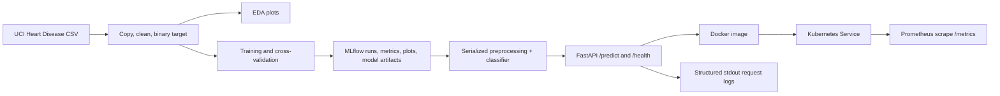

# Heart Disease Binary Classification

A machine-learning project that prepares the UCI heart-disease
dataset, trains a binary classifier, and serves predictions through a
Dockerized FastAPI application.

> **Important:** This is a learning project, not a medical device. Its output
> is not a diagnosis or a substitute for professional medical advice.

## Project overview

The original CSV contains 920 records from four data sources. The source
`num` field is converted to a binary target:

- `0` — no disease reported
- `1` — any positive `num` value (`num > 0`)

The data preparation script works on a copy and does not modify the source
CSV. It removes duplicate records (ignoring the row ID), treats zero values
in `trestbps` and `chol` as missing placeholders, converts `fbs` and `exang`
to numeric indicators, and removes the original `id` and `num` columns.
Remaining missing values are imputed inside the model pipeline, so imputation
statistics are learned from training data only.

## Files

- `heart-disease-data/heart_disease_uci.csv` — original input dataset
- `download_dataset.py` — downloads and combines the four processed files
  directly from the UCI repository
- `analyze_heart_disease.py` — dependency-free descriptive dataset summary
- `run_eda.py` — creates class balance, feature distribution, correlation,
  missingness, and source-level target plots
- `track_experiments.py` — logs model comparison, tuning, metrics, plots, and
  model artifacts to MLflow
- `prepare_dataset.py` — creates the working copy and cleaned binary dataset
- `train_binary_classifier.py` — compares baseline models and saves a model
- `evaluate_model.py` — tunes models and reports feature/per-source analysis
- `evaluate_without_source.py` — compares source-feature variants, tunes a
  decision threshold, and saves the API model artifact
- `test_data_model.py` — checks dataset preparation and model inference
- `app.py` — FastAPI health and prediction endpoints
- `test_app.py` — API tests
- `Dockerfile` and `.dockerignore` — container build configuration
- `compose.yaml` and `prometheus.yml` — local API + Prometheus monitoring
- `k8s/` — Kubernetes API and Prometheus manifests
- `.github/workflows/ci.yml` — lint, data/EDA, experiment, test, and container
  workflow
- `requirements.txt` — pinned runtime dependency versions
- `requirements-mlops.txt` — runtime requirements plus pinned MLflow tracking
- `requirements-dev.txt` — development and test tools
- `REPORT.md` — assignment project report

The generated CSVs and model artifacts are written under `working-data/`.
The Docker image requires `working-data/final_model_no_source.joblib`.

## Run locally

Use Python 3.14, matching the Docker image and the environment used to create
the saved model. From the repository root:

```bash
python3.14 -m venv .venv
source .venv/bin/activate
python -m pip install -r requirements.txt
```

### Dataset acquisition

The source is the UCI Machine Learning Repository's [Heart Disease
dataset](https://archive.ics.uci.edu/dataset/45/heart+disease). The project
includes the combined 920-row CSV at
`heart-disease-data/heart_disease_uci.csv`. To download the four original
processed source files and combine them into the project schema, run:

```bash
python download_dataset.py
```

This refreshes the source CSV from UCI. Then run `python prepare_dataset.py`;
that script preserves the downloaded source and creates its own working copy.
Use `python download_dataset.py --output /tmp/heart_disease_uci.csv` to save a
separate copy instead of replacing the project input.
The supplied combined CSV and the four current UCI files contain the same
feature/target records, but one record (`age=28`, male, atypical angina) is
assigned to Cleveland in the supplied file and Hungary in the original UCI
source files. The downloader preserves UCI's original source attribution
(303 Cleveland / 294 Hungary); the supplied CSV has 304 / 293. The final
classifier does not use the source feature.

Inspect and prepare the data, then generate the final model artifact:

```bash
python analyze_heart_disease.py
python prepare_dataset.py
python run_eda.py
python evaluate_without_source.py
```

EDA plots are saved under `artifacts/eda/`:

- `01_class_balance.png`
- `02_numeric_distributions.png`
- `03_numeric_correlations.png`
- `04_missingness.png`
- `05_target_by_source.png`

The cleaned target contains 410 negative cases and 508 positive cases. The
charts below are generated by the script rather than manually edited:


## Architecture



The preparation script preserves the original CSV and creates:

- `working-data/heart_disease_uci_copy.csv`
- `working-data/heart_disease_clean.csv`

The evaluation script saves:

- `working-data/final_model_no_source.joblib`

### MLflow experiment tracking

Install the MLflow-enabled dependencies and log four tracked runs (majority
baseline, tuned logistic regression with source, tuned random forest with
source, and tuned logistic regression without source):

```bash
python -m pip install -r requirements-mlops.txt
python track_experiments.py
```

Each run records its model/search configuration, cross-validation metrics,
held-out test accuracy/precision/recall/F1/ROC-AUC, model artifact, tuning
results where applicable, and confusion-matrix/ROC plots. The local tracking
database (`mlflow.db`) and artifacts (`mlruns/`) are excluded from Git.
Browse the tracked runs with:

```bash
mlflow ui --backend-store-uri sqlite:///mlflow.db
```

Then open <http://127.0.0.1:5000>. The final no-source run also writes the
model artifact used by the API to `working-data/final_model_no_source.joblib`.

To compare the basic baseline models and the tuned-model/feature-analysis
outputs, run:

```bash
python train_binary_classifier.py
python evaluate_model.py
```

Start the API locally:

```bash
uvicorn app:app --reload
```

Then visit <http://127.0.0.1:8000/docs> for interactive Swagger documentation.

## API

### Health check

```http
GET /health
```

Example response:

```json
{"status": "ok", "model_loaded": true}
```

### Prediction

```http
POST /predict
Content-Type: application/json
```

Example request:

```json
{
  "age": 62,
  "sex": "Female",
  "cp": "asymptomatic",
  "trestbps": 140,
  "chol": 268,
  "fbs": 0,
  "restecg": "lv hypertrophy",
  "thalch": 160,
  "exang": 0,
  "oldpeak": 3.6,
  "slope": "downsloping",
  "ca": 2,
  "thal": "normal"
}
```

The selected dataset record has `num=3`, so its ground-truth binary class is
positive. A model prediction is an estimate and is not guaranteed to match an
individual record.

Example response:

```json
{
  "prediction": 1,
  "label": "disease",
  "probability": 0.7561,
  "threshold": 0.44000000000000006
}
```

`prediction` is `1` when the estimated probability is at least the saved
threshold; otherwise it is `0`. `fbs` and `exang` accept `0` or `1`. Other
measurements and categorical features may be omitted or set to `null` and will
be handled by the model's preprocessing pipeline. The `dataset` source field
is intentionally not required by this API.

## Docker

The Docker CLI must be available on your `PATH` and Docker Desktop must be
running. Build the image from the project root after generating the model
artifact:

```bash
docker build -t heart-api:latest .
docker run --rm -p 8000:8000 heart-api:latest
```

Open <http://localhost:8000/docs> to try the API. Check container health with:

```bash
docker ps
docker inspect --format='{{.State.Health.Status}}' <container-id>
```

The image uses the pinned Python dependencies, runs as a non-root user, and
includes a Docker health check. It listens on the hosting platform's `PORT`
environment variable and defaults to port `8000` for local use.

### Publish a public demo with Render

The repository includes `render.yaml` for a free Render web service. Push the
project, including the model artifact, to GitHub, then:

1. Sign in to Render and choose **New → Blueprint**.
2. Connect the `MLOOPS` GitHub repository and select the branch to deploy.
3. Review the Blueprint's `heart-disease-api` web service and deploy it.
4. When deployment succeeds, open the service's **URL**. Check `/health`,
   `/docs`, and submit a request to `/predict`.

Render will build the repository's Dockerfile and redeploy on later commits.
The free service may sleep when idle, so the first request after a quiet period
can take longer. The service is publicly accessible; this educational demo has
no authentication or rate limiting. Do not send real patient data, and do not
use its output for diagnosis or treatment.

## Local Kubernetes deployment and monitoring

This project includes a local Kubernetes deployment for Docker Desktop. Enable
Kubernetes in Docker Desktop settings and confirm the `docker-desktop`
context is available. Build the image locally before applying the manifests:

```bash
docker build -t heart-api:latest .
kubectl config use-context docker-desktop
kubectl apply -f k8s/api.yaml
kubectl apply -f k8s/monitoring.yaml
kubectl get pods,services
```

If Docker Desktop uses a different Kubernetes context, select that context
instead. Access the API and Prometheus using port forwards:

```bash
kubectl port-forward service/heart-api 8000:8000
kubectl port-forward service/prometheus 9090:9090
```

Use <http://127.0.0.1:8000/docs> to submit predictions and
<http://127.0.0.1:9090> to inspect Prometheus. Example PromQL queries:

```promql
sum by (status) (rate(heart_api_requests_total[5m]))
histogram_quantile(0.95, sum by (le) (rate(heart_api_request_duration_seconds_bucket[5m])))
```

API logs are emitted to stdout without patient request bodies. View them with:

```bash
kubectl logs -f deployment/heart-disease-api
```

The API's Prometheus scrape endpoint is `GET /metrics`. It exposes request
counts by method/path/status and request-duration histograms.

Tear down the local deployment when finished:

```bash
kubectl delete -f k8s/monitoring.yaml
kubectl delete -f k8s/api.yaml
```

### Run API and Prometheus with Docker Compose

If Kubernetes is not enabled, Compose can run the API and Prometheus locally:

```bash
docker compose up --build -d
```

Open <http://127.0.0.1:8000/docs> for the API and
<http://127.0.0.1:9090> for Prometheus. Generate API traffic by submitting
predictions, then query `heart_api_requests_total` in Prometheus. If those
ports are already occupied, choose different host ports:

```bash
API_PORT=8001 PROMETHEUS_PORT=9091 docker compose up --build -d
```

Stop the services with `docker compose down`.

## Evaluation results

Results below are from the current fixed random seed (`42`) and dataset copy.
The final API model is logistic regression without the `dataset` source
feature. The train/test split is stratified, with 80% for training and 20%
held out for final evaluation. Hyperparameter selection and threshold
selection use training data only.

| Evaluation | Result |
| --- | ---: |
| 5-fold training CV ROC AUC, final model | 0.892 |
| Held-out test ROC AUC, final model | 0.928 |
| Held-out test accuracy at threshold 0.44 | 0.859 |
| Held-out test precision at threshold 0.44 | 0.839 |
| Held-out test recall at threshold 0.44 | 0.922 |
| Mean leave-one-source-out AUC | 0.813 |

Threshold `0.44` was selected to optimize F1 on out-of-fold training
predictions. On this test split it trades a small amount of precision for
higher recall compared with the default `0.50` threshold. These metrics are
specific to this dataset and split; they should not be interpreted as a
guarantee of real-world performance.

## Limitations

- Source-level generalization is weaker than the random held-out split:
  leave-one-source-out AUC was about `0.73` for Switzerland and `0.74` for VA
  Long Beach, compared with about `0.89` for Cleveland and `0.90` for Hungary.
- Missingness differs substantially between sources. For example, `ca` and
  `thal` have many missing values, so predictions can be sensitive to the
  data source and available features.
- This is a small, historical dataset with heterogeneous measurement
  practices. External validation on representative, current data is needed
  before considering any real-world use.
- The API accepts only the categories and ranges encoded in its request
  schema. Invalid values return a validation error.

## Tests

The tests cover API validation/prediction, prepared-data invariants, and saved
model inference. Install the development and MLflow tools, then run:

```bash
python -m pip install -r requirements-dev.txt
pytest -q
```

GitHub Actions runs linting, data preparation/EDA, tracked model training,
tests, Docker build, and a container API smoke test on pushes and pull
requests. EDA charts and MLflow data are uploaded as workflow artifacts.
