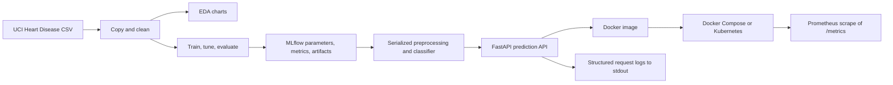
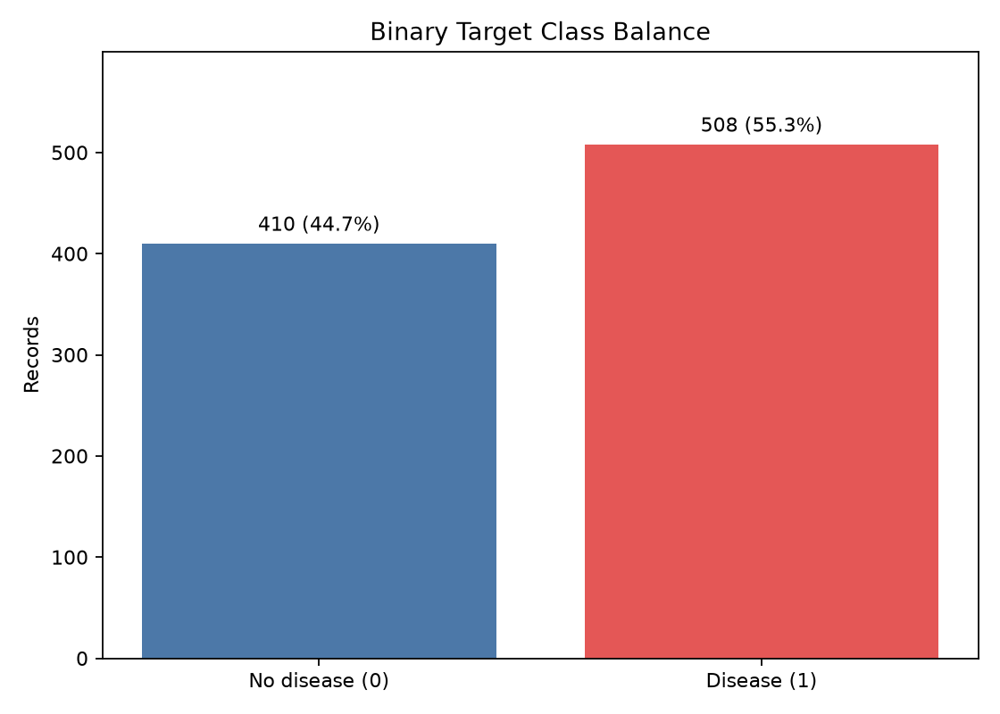
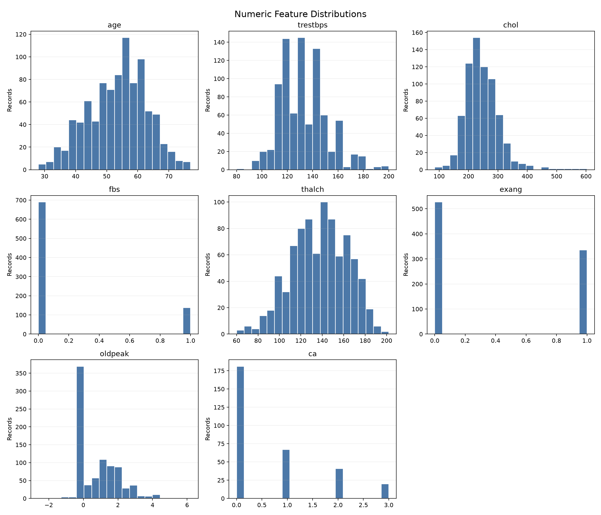
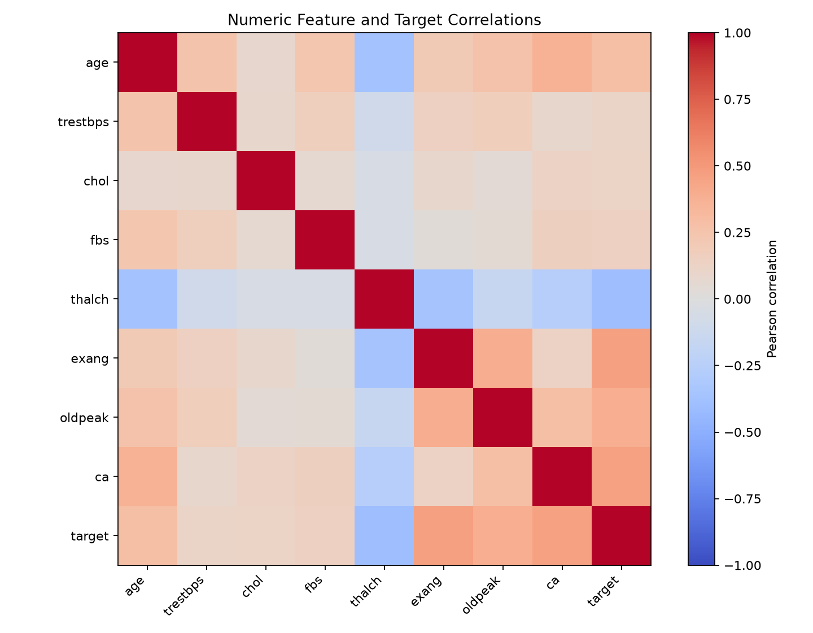
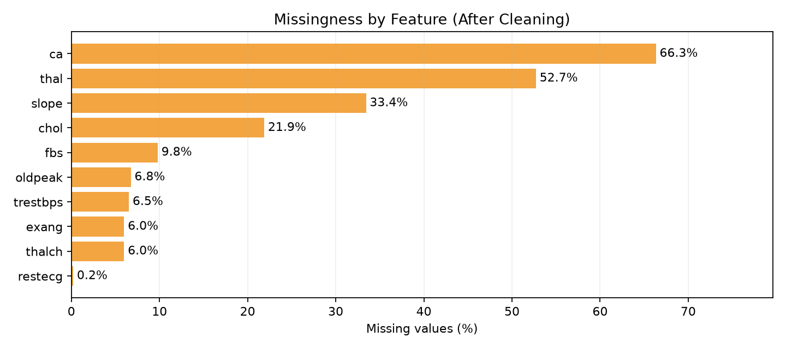
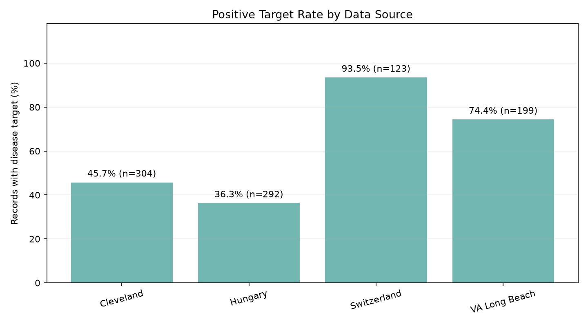

# Heart Disease Risk Classification

## MLOps Assignment 01 — AIMLCZG523

**Project report**

**Student:** _Add your name and ID_  
**Course:** Machine Learning Operations (MLOps)  
**Dataset:** UCI Heart Disease dataset  
**Date:** 18 October 2026

> This project is an educational demonstration. The classifier is not a
> medical device and must not be used to diagnose, treat, or make decisions
> about a person's health.

<div style="page-break-after: always;"></div>

## 1. Executive summary

This project implements a reproducible binary-classification workflow for the
UCI Heart Disease dataset. It covers data inspection and cleaning, exploratory
visualization, model comparison and tuning, local MLflow experiment tracking,
an API for inference, Docker packaging, automated tests, continuous
integration, and Prometheus monitoring.

The source data contains 920 records and a `num` outcome with values from 0 to
4. The binary target is 0 for `num = 0` and 1 for `num > 0`. Data quality
checks found two duplicate records and zero placeholders in measurements for
which zero is not a plausible value. Cleaning removes the duplicates, maps the
placeholders to missing values, and preserves the original CSV.

The selected model is logistic regression without the source-institution
feature. It was chosen after stratified cross-validation and hyperparameter
search. In the recorded split it reached a 0.928 held-out ROC-AUC. A threshold
of 0.44 was selected from out-of-fold training predictions to prioritize
recall; test recall was 0.922 and precision was 0.839. Leave-one-source-out
tests revealed a meaningful generalization gap, so the random-split score
should not be read as a guarantee for a new hospital.

The API uses FastAPI, validates feature inputs, returns a binary prediction
and probability, logs request metadata without logging patient data, and
exposes Prometheus metrics. Docker and Docker Compose were built and exercised
locally. Kubernetes manifests and a GitHub Actions workflow are included.
Actual Kubernetes deployment remains pending because Kubernetes is currently
disabled in Docker Desktop; a GitHub-hosted workflow run also requires pushing
the repository to GitHub.

<div style="page-break-after: always;"></div>

## 2. Objective and system architecture

The objective is to build and operationalize a classifier that predicts
whether a record indicates heart disease, while preserving a repeatable path
from source data to a deployed inference API.



The source file is treated as immutable. `prepare_dataset.py` copies it to
`working-data/heart_disease_uci_copy.csv` and produces
`working-data/heart_disease_clean.csv`. The full preprocessing pipeline is
serialized with the estimator, so inference applies the same imputation,
scaling, and encoding as training. `app.py` loads that artifact at startup.

Operational elements are intentionally separate: MLflow run metadata is
stored locally in SQLite; model artifacts are associated with individual
runs; Docker packages only the serving code, pinned runtime requirements,
and the selected inference model. Prometheus scrapes `/metrics` over the
container network, and API logs are written to standard output for container
log collection.

## 3. Dataset source and acquisition

The cited source is the [UCI Machine Learning Repository Heart Disease
dataset](https://archive.ics.uci.edu/dataset/45/heart+disease). The project
uses the supplied combined CSV at
`heart-disease-data/heart_disease_uci.csv`, which has 920 records and 16
columns, including four source datasets: Cleveland, Hungary, Switzerland, and
VA Long Beach.

For exact reproduction, use the combined CSV included with the project. The
`download_dataset.py` script can retrieve all four original processed UCI
files, map their categorical codes, and combine them into the expected schema.
It can save to a separate path for comparison or refresh the project input.
The preparation script then works on a copy and never overwrites its input.
The supplied combined CSV and current UCI source files contain the same
feature/target records, but one record (`age=28`, male, atypical angina) is
assigned to Cleveland in the supplied file and Hungary in the original UCI
files. The downloader preserves UCI's original source attribution (303
Cleveland / 294 Hungary); the supplied CSV has 304 / 293. The final model
does not use the source feature.

The label is ordinal in the source (`num` ranges from 0 to 4). This assignment
uses a binary problem: `num = 0` becomes class 0 (“no disease”) and any
positive value becomes class 1 (“disease”). After removing two duplicate
records, the cleaned data contains 918 rows: 410 class-0 records and 508
class-1 records. The split is stratified to preserve this class proportion in
training and test subsets.

<div style="page-break-after: always;"></div>

## 4. Data quality and exploratory analysis

The source was inspected for schema, missing values, duplicates, unique
values, and numerical ranges. Two duplicate rows were identified when
comparing all fields except the row identifier. `trestbps` and `chol` contain
zero placeholders (one and 172 values respectively); these were marked
missing rather than treated as physiologically meaningful measurements.
Negative `oldpeak` values were retained because the feature can legitimately
be negative. Missing values in other columns were preserved for model
preprocessing.

The cleaned dataset has substantial missingness in some fields: `ca` has 609
missing values, `thal` 484, `slope` 307, and `chol` 201. Numeric features use
median imputation with missingness indicators; categorical fields use a
dedicated “missing” category. These transformations are fitted inside a
scikit-learn pipeline, preventing validation/test data from influencing
training statistics.

The EDA script creates a class-balance chart, numeric-feature histograms, a
numeric correlation heatmap, missingness percentages, and positive-label
rates by data source. The class distribution is moderately imbalanced but not
extreme.











`run_eda.py` regenerates all five figures after dataset preparation, saving
them under `artifacts/eda/`. The plots are generated from the prepared data
rather than manually edited.

<div style="page-break-after: always;"></div>

## 5. Features and model development

The row ID is not a predictive feature. The original `num` field is replaced
with the binary target. `fbs` and `exang` are represented as 0/1 indicators.
`dataset` is retained during source-level analysis but is omitted from the
final API model, which avoids requiring a hospital/source label at inference.

The preprocessing pipeline separates numeric and categorical fields:

- Numeric: median imputation, missingness indicators, and standard scaling
  for logistic regression.
- Categorical: constant imputation followed by one-hot encoding with
  unknown-category handling.
- Estimators: majority-class baseline, logistic regression, and random
  forest.

An 80/20 stratified train/test split is created using random seed 42. The
training set is used for five-fold stratified cross-validation and model
selection. Grid searches optimize ROC-AUC. The held-out test set is reserved
for the final comparison and threshold evaluation.

The no-source logistic regression uses a grid over regularization parameter
`C`; the best selected value was 0.1. Random forest was tuned over estimator
count, maximum depth, and minimum leaf size. The majority classifier serves
as a deliberately simple baseline, establishing performance without learned
feature relationships.

Results demonstrate that both learned models substantially outperform the
majority baseline by ROC-AUC. Logistic regression was selected for the API
because it has competitive discrimination, simpler behavior, and a smaller
artifact than the tuned forest. Feature importance checks using permutation
importance in the separate model-analysis script ranked chest-pain type among
the strongest signals; this is an association in this dataset, not a causal
medical conclusion.

<div style="page-break-after: always;"></div>

## 6. Experiment tracking and evaluation

MLflow records four runs in the
`heart-disease-binary-classification` experiment: majority baseline, tuned
logistic regression with source, tuned random forest with source, and tuned
logistic regression without source. Each run records its configuration,
seed, split and fold counts, cross-validation metrics, held-out metrics,
tuning results where applicable, serialized model artifact, and
confusion-matrix/ROC plots. The local tracking database is `mlflow.db`; the
local artifact directory is `mlruns/`.

| Model / run | CV ROC-AUC | Test ROC-AUC | Test accuracy | Test precision | Test recall |
|---|---:|---:|---:|---:|---:|
| Majority baseline | 0.500 | 0.500 | 0.554 | 0.554 | 1.000 |
| Logistic regression with source | 0.894 | 0.932 | 0.842 | 0.835 | 0.892 |
| Random forest with source | 0.891 | 0.928 | 0.832 | 0.832 | 0.873 |
| Logistic regression without source | 0.892 | 0.928 | 0.859 | 0.839 | 0.922 |

For the final run, a threshold of 0.44 was selected using out-of-fold
predictions from training data. On the held-out test set this threshold gave
F1 0.879. The 0.50 threshold is retained for the other model comparison rows
to make their predictions directly comparable. The majority model's high
recall comes from predicting the majority class for every record; its 0.500
AUC and low utility make that behavior clear.

Source-level validation trains on three source datasets and tests on the
fourth. Mean leave-one-source-out AUC was 0.813, approximately unchanged by
removing the `dataset` feature. Switzerland and VA Long Beach were weaker
(about 0.73 and 0.74) than Cleveland and Hungary (about 0.89 and 0.90). This
is important evidence that a random split overstates expected performance on
unseen source populations.

<div style="page-break-after: always;"></div>

## 7. Model packaging and API

The final artifact is
`working-data/final_model_no_source.joblib`. It contains the fitted
preprocessing/model pipeline and selected decision threshold. The API loads
the artifact during application startup and exposes:

- `GET /health` — reports whether the model loaded.
- `POST /predict` — validates patient features and returns binary prediction,
  label, probability, and decision threshold.
- `GET /metrics` — exports Prometheus request counters and duration
  histograms.

The Pydantic input model validates ranges and accepted categories. Optional
measurements can be omitted or passed as null; model preprocessing handles
missing inputs. The endpoint does not require the source dataset field and
does not log request payloads. A sample request and response are included in
the README and can be tried interactively through FastAPI's `/docs`.

The artifact uses the pinned scikit-learn, NumPy, SciPy, and joblib versions
listed in `requirements.txt`. `requirements-mlops.txt` adds MLflow; the
development requirements add Pytest, Ruff, and the FastAPI test-client
dependency. The model and preprocessing are saved together to avoid
reimplementing feature transforms during serving.

The API tests cover health, full and partial inputs, response structure,
invalid values, probability ordering on a selected pair of examples, and
metrics endpoint output. Data/model tests check source schema, target values,
cleaned-data invariants, and saved-model inference. The local suite currently
passes five tests.

<div style="page-break-after: always;"></div>

## 8. CI/CD and containerization

The GitHub Actions workflow at `.github/workflows/ci.yml` is configured to run
on pushes, pull requests, and manual dispatch. It installs the development
environment, lints with Ruff, prepares data, generates EDA charts, runs
tracked model training, executes tests, builds the Docker image, and performs
health and prediction smoke requests against a running container. EDA and
MLflow outputs are uploaded as workflow artifacts.

The workflow has been validated locally by running its substantive steps:
Ruff passed, five tests passed, MLflow created four runs with model/plot
artifacts, and the Docker image built successfully. The workflow itself has
not yet run on GitHub because a push to a GitHub repository is required.
After publishing this work, inspect the Actions run and retain its run URL
and screenshots for the final submission.

The Dockerfile uses `python:3.14-slim`, installs the pinned API dependencies,
copies only the API and final model, runs as a non-root user, and defines a
container health check. The image built and was run locally. `/health`
returned `model_loaded: true`, `/predict` returned a valid response, `/metrics`
showed request counters, and Docker marked the container healthy.

Docker Compose runs the API and Prometheus together. In the verified local
test, Prometheus reported its `heart-disease-api` scrape target as up and
returned `heart_api_requests_total`. The test services were stopped afterward;
the image remains available locally.

<div style="page-break-after: always;"></div>

## 9. Deployment, monitoring, and logging

Kubernetes deployment definitions are in `k8s/api.yaml` and
`k8s/monitoring.yaml`. The API Deployment has startup, readiness, and liveness
probes, bounded resource requests/limits, and a LoadBalancer Service.
Prometheus is configured to scrape the API Service's `/metrics` endpoint and
is exposed through a NodePort. Apply the manifests after enabling a local
Docker Desktop Kubernetes cluster:

```bash
kubectl config use-context docker-desktop
kubectl apply -f k8s/api.yaml
kubectl apply -f k8s/monitoring.yaml
kubectl get pods,services
```

At the time of this report, `kubectl` is installed but no cluster context is
configured; Docker Desktop reports Kubernetes as disabled. Therefore the
Kubernetes resources are provided but have not been deployed or screenshot
verified. Local monitoring has been demonstrated through Docker Compose
instead. This is a known remaining assignment action, not a claim of a
completed cluster rollout.

The API exposes:

- `heart_api_requests_total`, labeled by method, endpoint, and HTTP status.
- `heart_api_request_duration_seconds`, a histogram suitable for latency
  percentiles.

Structured log messages record request method, path, status, and elapsed time.
Patient feature values and request bodies are deliberately excluded. Operators
can inspect container logs with `docker compose logs -f heart-api` or
`kubectl logs -f deployment/heart-disease-api` after deployment.

The Prometheus UI can query request rates by status and calculate a latency
percentile. Example queries and local access instructions are in `README.md`.
The local service test confirmed the scrape target was up and the API counter
was visible after health checks.

<div style="page-break-after: always;"></div>

## 10. Reproduction, limitations, and completion checklist

From the repository root, the principal workflow is:

```bash
python -m pip install -r requirements-dev.txt
python prepare_dataset.py
python run_eda.py
python track_experiments.py
pytest -q
docker build -t heart-api:latest .
docker compose up -d
```

The local MLflow UI can be started with
`mlflow ui --backend-store-uri sqlite:///mlflow.db`. The API is documented at
`http://127.0.0.1:8000/docs`; Prometheus is available at
`http://127.0.0.1:9090` when using default Compose ports.

Important limitations are the small historical dataset, heterogeneous
measurement practices, substantial missingness, and reduced performance on
some source-held-out tests. A random holdout from pooled sources does not
represent external clinical validation. The label transformation collapses
the original 0–4 ordinal outcome and loses severity information. Threshold
choice trades precision against recall and should be based on an explicitly
defined application cost—not tuned for clinical use here.

### Submission evidence still to collect

- Push the repository and capture the successful GitHub Actions workflow page
  and uploaded artifacts.
- Enable Docker Desktop Kubernetes, apply the manifests, verify rollout and
  endpoints, and capture deployment/service and Prometheus screenshots.
- Record the required short video demonstrating data preparation, MLflow,
  tests/CI, container startup, and API/monitoring behavior.
- Add student name/ID, repository URL, and final evidence links to this report.

This project is intended to demonstrate a reproducible MLOps workflow for
coursework. It is not clinically validated and must not be used to make
healthcare decisions.
